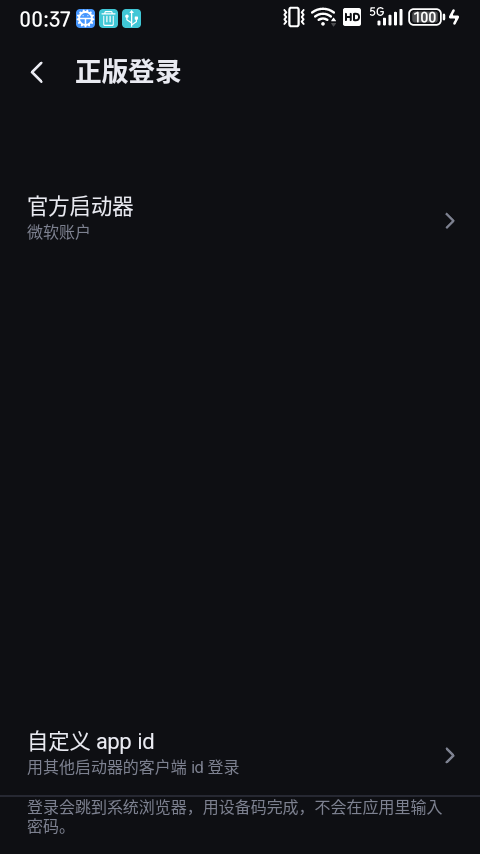
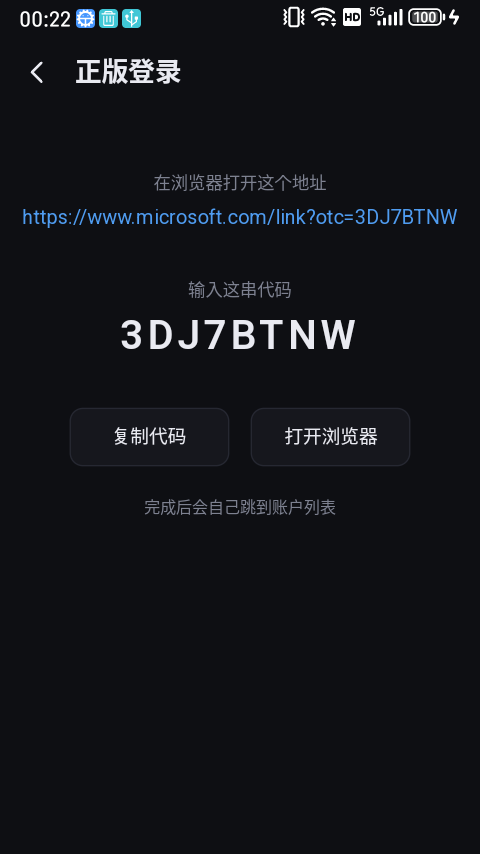

# Tessera Mobile

Tessera 的手机端界面。**Slint 渲染，不用 WebView。**

这一版只有骨架：底部三个页签（主页 / 下载 / 设置）可以切换，每个页面除标题外是空的。

## 结构

```text
TesseraMobile/
├── Cargo.toml          # 依赖、Android 打包元数据
├── build.rs            # 编译 ui/app.slint
├── ui/
│   ├── theme.slint     # 颜色与尺寸，唯一的字面量出处
│   ├── app.slint       # 窗口：页面区 + 底部栏，路由页签
│   ├── navbar.slint    # 底部栏、页签、三个手绘图标
│   ├── page.slint      # 三个页面共用的背景 + 标题
│   ├── home.slint
│   ├── download.slint
│   └── settings.slint
└── src/
    ├── lib.rs          # android_main / run()
    └── main.rs         # 桌面预览入口
```

## 跑起来

桌面（不用模拟器就能看布局，窗口按手机比例开）：

```sh
cargo run
```

Android（真机或模拟器接着 `adb` 就行）：

```sh
./scripts/deploy.sh          # 编译 → 安装 → 启动
```

首次在新机器上要准备：

```sh
rustup target add aarch64-linux-android
cargo install cargo-apk2
# Android SDK（build-tools + platforms）与 NDK r30+
export ANDROID_HOME=$HOME/java/android-sdk
export ANDROID_NDK_ROOT=$HOME/android-ndk-r30
```

两个容易踩的点：

- **NDK 必须 r30 或更新。** Slint 的 Android 渲染器只有 Skia 后端，用的是预编译
  Skia，链接的是 r30 的 C++ 运行时。用旧 NDK 能编过，但一启动就崩。
  （或者 `FORCE_SKIA_BUILD=1` 从源码编 Skia，非常慢。）
- **`minSdkVersion` 和 `targetSdkVersion` 都固定为 28。** 写在
  `[package.metadata.android.sdk]` 里。targetSdk 28 让应用留在旧的存储模型里
  （以后读写游戏目录不用和 scoped storage 打架），系统也不会强制边到边布局。
  cargo-apk2 会拿 `platforms;android-28` 当编译平台，所以 SDK 里要有这一份。
- **`cargo-apk2` 的元数据键名和 `cargo-apk` 不一样。** 现在用的是
  `[package.metadata.android.sdk]` 下的 `min_sdk_version` / `target_sdk_version`，
  以及 `[package.metadata.android.application]` 下的 `label`。写成
  `min-sdk` / `label`（顶格）会被静默忽略。

发布签名（debug 会自己生成 `debug.keystore`）：

```sh
export CARGO_APK_RELEASE_KEYSTORE=/path/to/key.jks
export CARGO_APK_RELEASE_KEYSTORE_PASSWORD=...
cargo apk2 build --release --target aarch64-linux-android --lib
```

## 真机截图

ZTE 7552N / Android 13 / 480×854：

| 主页 | 下载 | 设置 |
|---|---|---|
|  |  |  |

账户页（主页右上角进入）：


正版登录（设备码，浏览器是系统的）：

| 选择身份 | 等待授权 |
|---|---|
|  |  |

## 几个刻意的决定

- **不用 WebView。** 全部 Slint 原生绘制。
- **页面先空着。** 只有标题，用来确认页签切换。
- **底部栏是手绘的**，没有用 `std-widgets`：它是所有页面共用的那一块，
  等设计 token 接进来时要保持现在的形状。
- **位置全部显式给 x/y。** Slint 对只声明了大小的子元素会做居中摆放，
  页签栏需要的是精确坐标，所以没有依赖布局推断。
- **三等分用 `root.width / 3` 而不是 `horizontal-stretch`**：后者在这里没有生效。
- **字体用系统默认。** 桌面版那套像素字体不复刻，手机上也不需要。
- **安全区**：`Window.safe-area-insets` 从窗口传给页面（顶部）和底栏（底部），
  所以刘海和手势条不会盖住内容。桌面上这两个值都是 0。
  实测那台 ZTE 上顶部 inset 正常（约 24dp），**底部报 0**（手势导航模式），
  底栏因此贴到屏幕最下沿。如果后面发现手势区抢点击，再补一个最小底部留白。
- **窗口尺寸不在 `.slint` 里写死。** 写在 `Window` 上的 `width/height` 在 Android
  上会变成一个比屏幕还高的窗口，底栏直接被挤到屏幕外——第一版就是这么翻车的。
  现在只有桌面入口调 `set_size()`。

## 账户

从主页右上角进入，前台是一份 `tessera-core::accounts` 的移植：

- 一行一个账户文件，按玩家名排序；同一个名字登录两次就是 `Steve` / `Steve (1)`。
- 点一行 = 切换（桌面版是选中再按「切换」，手机上点就是切换）。
- 长按 = 移除，走一张确认卡片（对应桌面版的「再点一次」）。
- 右下「添加」二选一：**正版登录**（微软设备码）或**离线账户**（3–16 个
  `[A-Za-z0-9_]`，勾选后可任意）。
- 当前账户记在 `<data>/active_account`，存的是文件名不是路径。

账户文件放在 `<data>/凭据/账户/`，格式与桌面版相同，可以直接拷过来。

## 正版登录

`vendor/minecraft-auth` 就是桌面版用的那份代码，这里只是换了个前端：

1. 选身份：官方启动器、`凭据/启动器/azure_app_ids.toml` 里的第三方 app id，或者
   当场填一个 client id（「自定义 app id」）。
2. 工作线程拿设备码，UI 每 150ms 轮询一次 channel，不阻塞绘制。
3. 页面显示代码和地址，`复制代码` / `打开浏览器` 交给系统。
4. 成功后凭据写进同一个账户目录，账户页把它设为当前账户。

两件踩过的 Android 坑，写在这里免得再踩：

- **必须声明 `INTERNET` 权限。** 没有它 `connect` 直接 `EACCES`，reqwest 只会说
  "error sending request"，看不出是权限问题。
- **不能用 reqwest 默认的 `rustls` 校验。** 它走 `rustls-platform-verifier`，在
  Android 上没初始化 JNI 上下文就 panic（"Expect rustls-platform-verifier to be
  initialized"）。现在用 `use_preconfigured_tls` 配一份内置 Mozilla 根证书，
  两端行为一致；代价是不认用户自己装的 CA。

`打开浏览器` 和 `复制` 没有用 Slint——它的 Rust API 不暴露这两个能力——而是走
JNI 调 `Intent` / `ClipboardManager`，见 `src/platform.rs`。

## 下一步

- Microsoft 登录（`vendor/minecraft-auth` 已经放进来，还没接）：设备码流程比内嵌
  浏览器更适合手机。
- 账户页现在只在打开时读盘；等有了下载/安装，再按 `tessera-core` 的 `Effect`
  那套把后台任务接起来。
