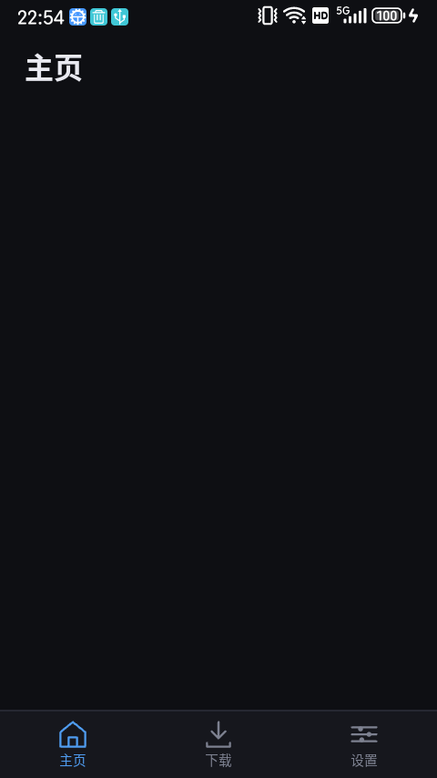
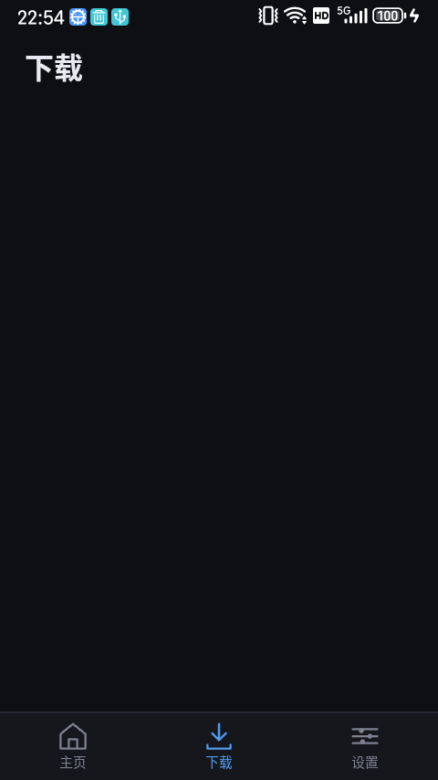
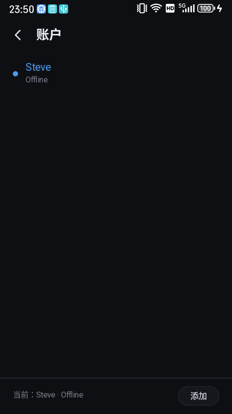

# Tessera Mobile

Tessera 的手机端界面。**Slint 渲染，不用 WebView。**

这一版只有骨架：底部三个页签（主页 / 下载 / 设置）可以切换，每个页面除标题外是空的。

## 结构

```text
TesseraMobile/
├── Cargo.toml          # 依赖、Android 打包元数据
├── build.rs            # 编译 ui/app.slint
├── ui/
│   ├── theme.slint     # 颜色与尺寸，唯一的字面量出处
│   ├── app.slint       # 窗口：页面区 + 底部栏，路由页签
│   ├── navbar.slint    # 底部栏、页签、三个手绘图标
│   ├── page.slint      # 三个页面共用的背景 + 标题
│   ├── home.slint
│   ├── download.slint
│   └── settings.slint
└── src/
    ├── lib.rs          # android_main / run()
    └── main.rs         # 桌面预览入口
```

## 跑起来

桌面（不用模拟器就能看布局，窗口按手机比例开）：

```sh
cargo run
```

Android（真机或模拟器接着 `adb` 就行）：

```sh
./scripts/deploy.sh          # 编译 → 安装 → 启动
```

首次在新机器上要准备：

```sh
rustup target add aarch64-linux-android
cargo install cargo-apk2
# Android SDK（build-tools + platforms）与 NDK r30+
export ANDROID_HOME=$HOME/java/android-sdk
export ANDROID_NDK_ROOT=$HOME/android-ndk-r30
```

两个容易踩的点：

- **NDK 必须 r30 或更新。** Slint 的 Android 渲染器只有 Skia 后端，用的是预编译
  Skia，链接的是 r30 的 C++ 运行时。用旧 NDK 能编过，但一启动就崩。
  （或者 `FORCE_SKIA_BUILD=1` 从源码编 Skia，非常慢。）
- **`minSdkVersion` 和 `targetSdkVersion` 都固定为 28。** 写在
  `[package.metadata.android.sdk]` 里。targetSdk 28 让应用留在旧的存储模型里
  （以后读写游戏目录不用和 scoped storage 打架），系统也不会强制边到边布局。
  cargo-apk2 会拿 `platforms;android-28` 当编译平台，所以 SDK 里要有这一份。
- **`cargo-apk2` 的元数据键名和 `cargo-apk` 不一样。** 现在用的是
  `[package.metadata.android.sdk]` 下的 `min_sdk_version` / `target_sdk_version`，
  以及 `[package.metadata.android.application]` 下的 `label`。写成
  `min-sdk` / `label`（顶格）会被静默忽略。

发布签名（debug 会自己生成 `debug.keystore`）：

```sh
export CARGO_APK_RELEASE_KEYSTORE=/path/to/key.jks
export CARGO_APK_RELEASE_KEYSTORE_PASSWORD=...
cargo apk2 build --release --target aarch64-linux-android --lib
```

## 真机截图

ZTE 7552N / Android 13 / 480×854：

| 主页 | 下载 | 设置 |
|---|---|---|
|  |  |  |

账户页（主页右上角进入）：



正版登录（设备码，浏览器是系统的）：

| 选择身份 | 等待授权 |
|---|---|
|  |  |

## 几个刻意的决定

- **不用 WebView。** 全部 Slint 原生绘制。
- **页面先空着。** 只有标题，用来确认页签切换。
- **底部栏是手绘的**，没有用 `std-widgets`：它是所有页面共用的那一块，
  等设计 token 接进来时要保持现在的形状。
- **位置全部显式给 x/y。** Slint 对只声明了大小的子元素会做居中摆放，
  页签栏需要的是精确坐标，所以没有依赖布局推断。
- **三等分用 `root.width / 3` 而不是 `horizontal-stretch`**：后者在这里没有生效。
- **字体用系统默认。** 桌面版那套像素字体不复刻，手机上也不需要。
- **安全区**：`Window.safe-area-insets` 从窗口传给页面（顶部）和底栏（底部），
  所以刘海和手势条不会盖住内容。桌面上这两个值都是 0。
  实测那台 ZTE 上顶部 inset 正常（约 24dp），**底部报 0**（手势导航模式），
  底栏因此贴到屏幕最下沿。如果后面发现手势区抢点击，再补一个最小底部留白。
- **窗口尺寸不在 `.slint` 里写死。** 写在 `Window` 上的 `width/height` 在 Android
  上会变成一个比屏幕还高的窗口，底栏直接被挤到屏幕外——第一版就是这么翻车的。
  现在只有桌面入口调 `set_size()`。
- **数据和实例都在 `/sdcard/Tessera`，启动即申请「所有文件访问权限」。** App 私有
  目录之外的读写只有 Android 11+ 的 `MANAGE_EXTERNAL_STORAGE` 能覆盖。这是系统
  设置里的开关，不是运行时弹窗，所以窗口拿到焦点后没有权限就跳转
  `MANAGE_APP_ALL_FILES_ACCESS_PERMISSION`；用户按返回仍没授权会再次跳转，授权后
  留在应用里并立刻创建数据目录、重新读账户。见 `src/platform.rs` 与 `lib.rs`
  里的权限轮询。

## 主页

进入主页时扫描 `/sdcard/Tessera/游戏/versions`：

- 只列含可读版本 JSON 的目录；id、渠道（正式版 / 快照 / 旧版）和 `releaseTime`
  的日期从 JSON 读，按 `releaseTime` 新到旧排列。
- 安装完成后会重新扫描并刷新计数；切回主页也会刷新。
- 长按一行会弹出菜单，目前只有「卸载」：删除 `versions/<目录>` 和对应的
  `缓存/<id>.txt`；共享的 `libraries/`、`assets/` 不删，可能还有别的版本在用。
- 点行启动还没有接。扫描逻辑在 `src/installed.rs`。

## 账户

从主页右上角进入，前台是一份 `tessera-core::accounts` 的移植：

- 一行一个账户文件，按玩家名排序；同一个名字登录两次就是 `Steve` / `Steve (1)`。
- 点一行 = 切换（桌面版是选中再按「切换」，手机上点就是切换）。
- 长按 = 移除，走一张确认卡片（对应桌面版的「再点一次」）。
- 右下「添加」二选一：**正版登录**（微软设备码）或**离线账户**（3–16 个
  `[A-Za-z0-9_]`，勾选后可任意）。
- 当前账户记在 `/sdcard/Tessera/active_account`，存的是文件名不是路径。

所有数据都在 **`/sdcard/Tessera`** 下，不使用应用私有目录（卸载重装不丢，也能通过
USB 直接拷）。账户文件放在 `/sdcard/Tessera/凭据/账户/`，格式与桌面版相同；
把桌面版的 `凭据/` 整个拷进去即可。

## 正版登录

`vendor/minecraft-auth` 就是桌面版用的那份代码，这里只是换了个前端：

1. 选身份：官方启动器、`/sdcard/Tessera/凭据/启动器/azure_app_ids.toml` 里的第三方 app id，或者
   当场填一个 client id（「自定义 app id」）。
2. 工作线程拿设备码，UI 每 150ms 轮询一次 channel，不阻塞绘制。
3. 页面显示代码和地址，`复制代码` / `打开浏览器` 交给系统。
4. 成功后凭据写进同一个账户目录，账户页把它设为当前账户。

两件踩过的 Android 坑，写在这里免得再踩：

- **必须声明 `INTERNET` 权限。** 没有它 `connect` 直接 `EACCES`，reqwest 只会说
  "error sending request"，看不出是权限问题。
- **不能用 reqwest 默认的 `rustls` 校验。** 它走 `rustls-platform-verifier`，在
  Android 上没初始化 JNI 上下文就 panic（"Expect rustls-platform-verifier to be
  initialized"）。现在用 `use_preconfigured_tls` 配一份内置 Mozilla 根证书，
  两端行为一致；代价是不认用户自己装的 CA。

`打开浏览器` 和 `复制` 没有用 Slint——它的 Rust API 不暴露这两个能力——而是走
JNI 调 `Intent` / `ClipboardManager`，见 `src/platform.rs`。

## 下载器（aria2c）

下载页和桌面版走同一条路线：`mdt-minecraft` 写 `aria2c --input-file` 列表，aria2
搬字节。手机端第一件事是先有 aria2c：

- 进入「下载」页时检查应用私有目录里的 `bin/aria2c`。没有就只显示安装卡片。
- 点「下载 aria2c」会从 GitHub 拉官方 `1.37.0` 的 aarch64 Android 构建，边下边算
  SHA-256，校验通过后解压出 `aria2c`、设为可执行，再跑一次 `--version` 确认。
- **二进制放在应用私有目录**（`Context.getFilesDir()/bin`），因为 `/sdcard` 是
  `noexec`；下载的游戏数据仍然在 `/sdcard/Tessera`。本项目 targetSdk 28，所以还允许
  从私有目录执行。
- 官方 Android 构建是 **API 33+**；更老的设备会通过校验但 `--version` 跑不起来，
  这时会删掉二进制并报错，而不是留下一个坏文件。

**装好 aria2c 之前，JRE 和运行库的卡片是灰的，按钮显示「先安装 aria2c」。** 只有
aria2c 自己用 reqwest 下载（鸡生蛋）；之后 JRE 的清单、JRE 压缩包、运行库的全部
AAR/jar 都由 aria2c 拉取。Android 没有 OpenSSL 默认 CA 路径，所以第一次会从
`/system/etc/security/cacerts`（Android 14+ 还有
`/apex/com.android.conscrypt/cacerts`）拼出 `files/ca.pem`，再传
`--ca-certificate`。依赖安装的进度从 aria2 的 `--show-console-readout` 行解析；
版本安装则直接刷 aria2 的 per-file notice 日志。

GitHub 下载统一走设置页的 GitHub Proxy：读写的还是桌面版那份
`/sdcard/Tessera/配置.toml` 里的 `github_proxy`，保存时只改这一个键，桌面版写的其他
字段原样保留。候选顺序和桌面版一致：`proxy/host/...`、`proxy/https://host/...`，
最后直连。

## JRE

下载页的第二张卡。JRE 来自
[Tessera-Launcher/BuildJRE4Android](https://github.com/Tessera-Launcher/BuildJRE4Android)，
不需要 GitHub API：

1. 取 `releases/latest/download/jre-manifest.json`。
2. 读 `files.zip.name` / `sha256` / `size`。
3. 下载 `releases/latest/download/<zip name>`，校验后解压。

安装在 **应用私有目录** `files/jre`（`dlopen` 不能从 `noexec` 的 `/sdcard` 加载）。
先解到 `files/jre.incoming`，完整后再改名替换，所以中断不会留下一个被当成“已安装”的
半套 JRE。当前清单是 `safe` 档、arm64-v8a、minSdk 28，解包约 117 MB，下载约 40 MB。
清单和压缩包都由 aria2c 下载（见上一节），安装完成会显示用了哪个代理候选。

## Android 运行库（借用 FCL）

Mojang 清单里的 LWJGL natives 是桌面 glibc 构建，Android 上加载不了。这里直接借
Fold Craft Launcher 的做法：不用 Mojang 的 LWJGL，整套换成 FCL 的 Android 构建。

- 固定在 FCL commit `722e2361f8f3013b6ebc026e52749c1bf3b5be71`
  （含 LWJGL 3.4.1 的 shaderc natives 修复）。
- 从 `https://github.com/FCL-Team/FoldCraftLauncher/raw/<commit>/...` 取：
  - `FCL/libs/lwjgl-3.4.1-natives-release.aar`（解出 `natives/arm64-v8a/*.so`）
  - `FCL/libs/openal-soft-release.aar`、`FCL/libs/SDL-release.aar`（解出 `jni/arm64-v8a/*.so`）
  - `FCL/libs/MobileGlues-release.aar`（解出 `jni/arm64-v8a/libmobileglues.so`，FCL 内置 2.0.1）
  - `FCL/src/main/assets/app_runtime/lwjgl/3.4.1/*.jar`（13 个 Java 模块）
  - 7 个 JNA 版本的 `libjnidispatch.so`
- 每个文件都带 SHA-256，由 aria2c 下载、校验、解压到应用私有
  `files/runtime/{lwjgl/3.4.1,native/arm64-v8a,jna/<version>}`，不写 `/sdcard`。
- URL 用 `github.com/.../raw/...` 而不是 `raw.githubusercontent.com`，这样
  gh-proxy 的 `github.com/...` 前缀规则都能用。
- 下载约 46 MB，装好约 36 MB。其他渲染器 AAR（GL4ES/Zink）暂不下载。

启动参数还没接，但目标形态是 FCL 那一套：`-Dos.name=Linux`、
`-Dorg.lwjgl.librarypath=<private>/runtime/lwjgl/3.4.1/natives/arm64-v8a`、
`-Dorg.lwjgl.openal.libname=<private>/runtime/native/arm64-v8a/libopenal.so`、
`-Djna.boot.library.path=<private>/runtime/jna/<version>`，以及把
`java.library.path` 指到这些私有目录和 `/system/lib64`、`/vendor/lib64`。

MobileGlues 按 FCL 的接法：`-Dorg.lwjgl.opengl.libname=libmobileglues.so`、
`-Dorg.lwjgl.egl.libname=libmobileglues.so`，环境变量
`POJAV_RENDERER=opengles3_mobileglues`、`LIBGL_ES=3`、`LIBGL_EGL=libmobileglues.so`、
`POJAVEXEC_EGL=libmobileglues.so`、`MG_DIR_PATH=<private>/mobileglues`。

## 版本列表

aria2c、JRE、运行库（含 MobileGlues）三项都装好后，下载页从依赖卡片切换到版本列表：

- 版本索引来自 `vendor/mdt-minecraft`，先走 BMCLAPI，失败自动回落 Mojang。
- MDT 默认会构造自己的 reqwest client；Android 上那条路会走
  `rustls-platform-verifier` 并 panic，所以本地给 MDT 打了一个小补丁：
  注入 `HttpDownloader` 时跳过默认 client（记录在 `vendor/mdt-minecraft/VENDORED.md`）。
- 列表显示版本号、渠道（正式版 / 快照 / 旧版）和发布日期，按清单原顺序（新到旧）。
- 搜索框按版本 id 子串过滤，大小写不敏感；搜索时不做折叠，避免把匹配项藏起来。
- 类型筛选：全部 / 正式版 / 快照 / 旧版，和桌面版的语义一致；切换筛选会折叠回初始状态，
  选择写在 `配置.toml` 的 `download_filter`（与桌面版同一个键）。
- 「全部」且没有搜索时启用折叠：同一家族的连续快照（`1.21.9-pre9 ~ 1.21.9-pre1`、
  `26.4-snapshot-10 ~ ...`、按年份归组的每周快照）以及同前缀的旧版本（`b1.x`、`a1.x`、
  `c0.x`、`rd-*` 等）合成一行；点行首箭头展开/收起，子项缩进。
- 进入下载页或最后一项依赖装完时自动拉取；右上角「刷新」强制重取。
- 点一个版本进入单独的安装页：MDT 把完整清单写到 `/sdcard/Tessera/缓存/<id>.txt`，
  `org.lwjgl*` 不进入清单（用 FCL 运行库包），natives 也不再由 MDT 处理；
  aria2c 读同一份清单下载，校验通过即结束。没有弹窗，也没有进度条。

## 版本安装

点版本列表里的一行，先整页切到「附加内容」，选 `无` 或
`Fabric Loader & API`，再按「安装」进入下载页：

- MDT 只解析元数据，并把完整的 `aria2c --input-file` 清单写到
  `/sdcard/Tessera/缓存/<id>.txt`；它和桌面版交给 aria2 的是同一种文件。
- 选 Fabric 时：
  - 从 `meta.fabricmc.net` 取最新稳定 Loader 版本，调用 MDT 的
    `plan_loader`，版本目录形如 `26.3-fabric-0.20.1`；
  - Fabric API 先查 `maven.fabricmc.net`，拿不到捆绑 jar 再回落 Modrinth；
  - API jar 写进 `versions/<id>/mods/`；API 解析失败只记日志，不放弃 Loader。
- aria2c 的参数照桌面版抄：`-j16 -x1 -s1`、`--console-log-level=notice`、
  `--show-console-readout=false`、`--summary-interval=0`、`--max-tries=3`、
  `--stop-with-process`，Android 额外传 `--ca-certificate`。
- 安装页只有一个活动日志框：aria2 每完成一个文件就追加一行，只保留最近 12 行，
  持续刷新。没有进度条，也不解析 `[#gid]` 或走 JSON-RPC。
- aria2 退出后跑 `plan.verify`；失败就停在日志和错误摘要，不自动重试整份清单。
- 校验通过后对清单里所有 `.jar` 做去签名 / 去密封（`src/jar.rs`，从桌面版
  `jar::normalize` 移植），客户端、libraries 和 Fabric API 都包括。
- 成功后结果行给出总用时和平均速度（例如 `26.3 安装完成 · 用时
  4 分 12 秒 · 平均 2.3 MB/s`）。返回按钮在安装结束后才出现。
- 游戏目录仍是 `/sdcard/Tessera/游戏`，布局和桌面版一致：
  `versions/`、`libraries/`、`assets/`。

真机验证：
- `26.3`：过滤 LWJGL 前 5203 个文件、574.3 MB 清单，校验通过。
- `26.3-fabric-0.20.1`：5200 个文件，Fabric API `0.166.2+26.3` 已写入
  `mods/`，校验通过，用时 3 分 46 秒、平均 2.5 MB/s。
- 过滤后主机侧生成同一版本的清单是 5194 个文件，没有 `org/lwjgl` 或 native
  jar；Android 的规则还会再排除只给 Linux 的 jtracy 原生包。

## 设置

GitHub Proxy，和桌面版同一个文件、同一个键。页面底部注明 Android 运行库借用自
Fold Craft Launcher，以及 LWJGL/SDL/OpenAL 的许可证。

## 启动（实验）

主页点一行会打开全屏 Java `GameActivity`，Surface 就绪后 JVM 用 JvmTest 的路线在当前进程里启动：

- 绝对路径预加载 `libc++_shared.so` / JRE 库 / `libjvm.so`；
- `JNI_CreateJavaVM` 在新线程上创建 VM；
- classpath 过滤 Mojang 的 LWJGL，换成 FCL 的 3.4.1 jar；
- 自动补 `java.compiler`（safe JRE 没有）和 FCL `CallbackBridge` 兼容类；
- 日志写到 `files/game.log`。

SDL 现在由一个独立的 Java `GameActivity` 承载：它创建 `TextureView`，在
ART VM 里先加载 `libpojavexec.so` 并安装 FCL 的 SDL hook，再把 Surface 交给
`SDLActivity`/`SDLSurface`；Rust 侧只负责 Surface 就绪后启动 JVM，并在游戏线程调用
`SDL_SetMainReady`。SDL 的 Java 宿主和 `CallbackBridge` 在 `android/java/`，
FCL 的 `libpojavexec`/`libfcl`/`libbytehook`/`libandroidnsbypass` 与 SDL 二进制在
`android/jniLibs/arm64-v8a/`。

真机已经跑通：

- SDL3 的 `nativeSetupJNI()`、`surfaceCreated()`、`surfaceChanged()`；
- SDL 初始化不再报 `did you include SDL_main.h`；
- Fabric 0.20.1 + Minecraft 26.3 进入 Render thread；
- 设置 `SDL_OPENGL_LIBRARY` / `SDL_EGL_LIBRARY` 指向 MobileGlues 后，
  `glGetError mismatch` 已消失，SDL 创建窗口成功；
- 当前黑屏原因推进到 Minecraft 26.3 的 shader 编译：
  `S0015: Outputs declared as arrays may only be indexed by a constant integral expression`，
  需要继续处理 MobileGlues/SFPEW 的 GLSL 翻译。

## 下一步

- 主页点版本启动；启动时也要对 classpath 和 `mods/` 再跑一遍 `jar::normalize`，
  修复在去签名规则加入前安装的版本。启动参数按 FCL 的形态接上（`os.name`、`org.lwjgl.librarypath`、
  `java.library.path`、JNA 路径）。MDT 已经不再列出 Mojang 的 `org.lwjgl*` 库，
  natives 也不再下载或解压，全部由运行库包提供。
- 账户页现在只在打开时读盘；等启动流程接上，再按 `tessera-core` 的 `Effect`
  那套把后台任务接起来。
